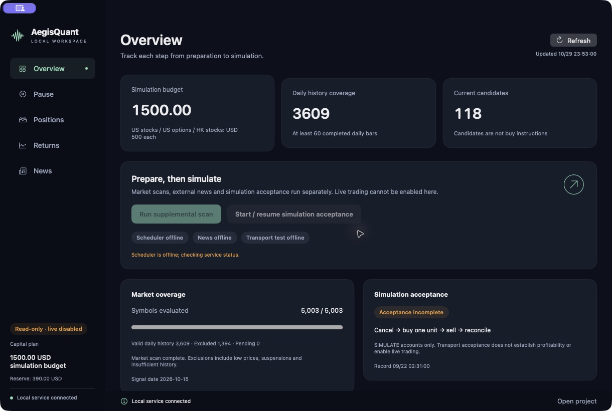

# AegisQuant

**English** | [简体中文](README.zh-CN.md)

An English-language securities console for **US and Hong Kong stocks, US options, and futures research**. It connects market data, news, screening, risk controls, simulation execution and reconciliation.

## Platforms and current scope

AegisQuant uses securities API adapters and is not branded for a single broker. A platform with a suitable API can be an integration target. **The current implementation includes one SDK / local-gateway adapter; entering an arbitrary broker API key does not make that platform compatible.** Additional adapters must implement and validate quotes, history, accounts, positions, orders, cancellations and fills, including permissions, market rules and calendars. See [broker integration details](docs/broker-adapters.md).

| Market | Current scope |
| --- | --- |
| US stocks | Screening, long-only swing simulation, risk controls and reconciliation |
| Hong Kong stocks | Calendar, board-lot and tick validation, simulation execution and reconciliation |
| US options | Contract research and SIMULATE transport acceptance |
| Futures | Research and a reserved FUTURE accounting category; no execution runner, verified execution channel or allocated execution budget |

Publication does not establish live readiness, completed execution acceptance or profitability. The console does not enable live trading.

## Securities console



The actual English macOS securities console displaying existing local simulation ledgers and historical scan records. The capture uses a read-only status service; the broker gateway and trading workers are offline. No strategy was resumed and no order submitted. The displayed scan date is historical; USD 1,500 is a configured simulation budget, not live account equity or proof of broker connectivity or acceptance. Original diagnostics and news retain their source language.

## Runtime workflow

```text
Market data / historical candles / news
                  ↓
Validate completeness, freshness, instruments, and trading sessions
                  ↓
Strategy signals + news direction / risk filters
                  ↓
Check budgets, positions, loss limits, and pause controls
                  ↓
Simulation or an explicitly enabled execution channel
                  ↓
Query orders → verify fills → update positions and ledgers
                  ↓
Stop loss / take profit / trend reversal / time exit → reconcile
```

1. **Start and recover:** load local configuration and persistent ledgers, then recover known orders and positions. Connecting an account, saving settings, or restoring credentials does not start new entries.
2. **Collect and validate:** read quotes, closed candles, and news. Stale data, incomplete scans, unverified instruments, or abnormal account states block new entries.
3. **Evaluate:** generate candidate signals, then check news, capital, market sessions, position limits, and loss controls. A valid signal can still be rejected by risk checks.
4. **Execute and reconcile:** persist order intent and responses, query order status, and update the ledger from verified results. A timeout or unknown result requires investigation before any retry.
5. **Manage positions:** continue position protection, cancellation, and reconciliation. Pausing new entries does not mean positions are closed; closing a browser page does not stop the backend.

Each channel has its own configuration, account state, and execution safeguards. The rules below describe the published source; the corresponding modules and local configuration determine actual parameters.

## Trading logic

### US stocks

- A long-only short-term swing framework checks the underlying trend, liquidity, and a breakout above the previous five sessions' highs using completed daily data.
- An optional volatile-trend filter ranks candidates using ATR percentage and trend efficiency. Complete scans and qualified historical data are required for entry.
- Position size accounts for available capital, planned stop distance, fees, and slippage reserves.
- The swing model uses an initial stop distance of `1.5 × ATR14` and a target distance of `3 × ATR14`. Exit checks cover stops, targets, trend reversal, and a time-exit request near the close once five sessions have been held (execution and a flat position still require confirmation).
- Execution rechecks fresh two-sided quotes, limit prices, market calendars, news, and joint-account risk. Expired-order cancellation and existing-position exits take priority over new entries.

### Hong Kong stocks

- Entry checks use a verified Hong Kong trading calendar and a complete previous-session scan, including long signals, liquidity, and candidate identity.
- Execution also requires a continuous trading session, valid board lots and price ticks, fee reserves, an independent budget, and account reconciliation.
- Existing-position exits are managed independently of the current entry candidate list.

### US options

- The independent options flow primarily performs **SIMULATE transport acceptance**, rather than representing a validated profitable options strategy.
- Its sequence is `cancellation test → cancellation confirmation → buy → buy confirmation → sell → sell confirmation → full reconciliation`.
- Contracts, quotes, independent budgets, and positions are revalidated. Unfilled or unknown orders do not count as success and must not trigger blind replacement orders.

### Futures research

Futures remain a research and integration-check area. Contract eligibility, market-data access, multiplier, tick size, margin, fees, trading calendar, execution capability, and an independent budget must be verified before any executable strategy can be considered. This repository does not claim an enabled or accepted US/HK futures execution flow.

## Connect your securities API

Obtain official API access for your target markets and simulation accounts. Gateway APIs require the provider's local gateway; key/secret, OAuth and signed APIs require an adapter implementing the corresponding authentication. Keep credentials out of source control. Validate read-only account data before testing orders, cancellations, partial fills, unknown responses and reconciliation in the provider's simulation environment.

For the included local-gateway adapter:

```sh
python3 -m venv .venv
.venv/bin/python -m pip install -r requirements.txt
.venv/bin/python connect.py --port 11111 --quotes --accounts
.venv/bin/python trade.py --port 11111 doctor
cp trading/config.example.json data-local-config.json
.venv/bin/python trade.py --config data-local-config.json --port 11111 doctor
```

These are **adapter-specific commands, not universal broker commands**. Default gateway: `127.0.0.1:11111`; do not expose it publicly. `doctor` does not start strategies. See [adapter details](docs/broker-adapters.md). Keep `live_stocks` and `live_options` false. Configuration must pass `Config.validate()`. The older example uses NZD and does not reproduce the migrated USD ledgers in the screenshot. Replace and verify example account IDs `000001` (US) and `000002` (HK). Do not reset existing ledgers to bypass checks. Public clones do not contain original account bindings or acceptance records.

## Connect your AI analysis API (optional, read-only)

News monitoring currently uses rules. The separate `trading/ai_analysis.py` research CLI supports Chat Completions-compatible services; there is no GUI key-entry page or AI-to-order integration.

Obtain your provider's API base URL, supported model name and API key:

```sh
.venv/bin/python -m trading.ai_analysis \
  --base-url https://provider.example/v1 \
  --model your-model-name \
  --text 'Analyze this public announcement. Separate facts, assumptions, risks and invalidation conditions.'
```

Replace the example URL and model. The CLI prompts for a hidden key without saving it, or reads `AEGIS_AI_API_KEY`. HTTPS is required except on loopback HTTP. The endpoint must support `/chat/completions`. Securities and AI credentials are separate.

Only explicitly supplied research text is sent; account data, positions, ledgers and broker credentials are not loaded. Responses default to English; request another language in the text if desired. Providers may charge for calls. Requests time out after 45 seconds without automatic retries. Tests use isolated fake services; no paid live-provider validation is claimed.

## Layout and macOS launch

| Path | Purpose |
| --- | --- |
| `desktop/QuantDesktop.swift` | English macOS securities console |
| `trading/` | Data, scanning, simulation, reconciliation, risk and read-only AI research |
| `tests/` | Regression tests |
| `examples/` | Synthetic examples |
| Top-level Python scripts | Diagnostics, backtests and reporting |

Use a compatible macOS SDK and SwiftUI toolchain:

```sh
zsh desktop/build.sh
open AegisQuant.app
```

The build produces `AegisQuant.app`. A normal launch connects the local backend and manages tasks according to local configuration. Configure simulation accounts and permissions first. Launching with `AEGIS_READ_ONLY=1` prevents this app from starting its backend or sending action requests; an existing status service is required to display data. Closing the window does not stop background processes.

This sanitized source snapshot excludes runtime databases, balances, trade history, credentials, dependencies and built apps. Other separate tools retained in the repository do not participate in the securities console's connection or execution.

## Copyright, commercial use, and attribution / 版权、商业使用与来源标注

### English

**Copyright © 2026 Ffffsss123. All rights reserved except as expressly granted by the repository [LICENSE](LICENSE).** This notice covers original material the author has the right to license. Third-party components remain subject to their own licenses.

Personal use, study, modification, derivative development, commercial use, and profit-generating use are permitted only with clear attribution to the original author and this repository. Paid products, services, trading for profit, personal rewrites, republication, copying, and redistribution must retain the source and must not present the author's work as wholly independent original work.

Retain this notice and an accessible original repository link:

> Based on or uses AegisQuant by Ffffsss123.
>
> Original source: https://github.com/Ffffsss123/AegisQuant
>
> Copyright © 2026 Ffffsss123. Subject to the original repository LICENSE.

When providing software or services to others, include attribution in the README / documentation and a user-accessible About, Copyright, or Credits page. Source distributions must also retain the copyright and LICENSE. Private use or trading solely for your own profit requires retaining the notice in the used copy's README or equivalent project documentation, without publishing trading records.

Identify modified versions as modified and do not imply the author's endorsement. **Use that fails to satisfy attribution or other license conditions is outside the permission granted; the author reserves the right to seek cessation, pursue liability, and bring legal proceedings under applicable law.** See [LICENSE](LICENSE) for the complete terms.

### 简体中文

**Copyright © 2026 Ffffsss123。保留所有权利；使用许可仅按本仓库 [LICENSE](LICENSE) 授予。** 本声明适用于作者有权授权的原创部分，第三方组件仍遵循各自许可。

允许个人使用、学习、修改、二次开发、商业使用及盈利，但上述使用均必须明确注明原作者和本仓库来源。商业产品、收费服务、量化交易盈利使用、个人改写、转载、复制或分发均不得删除或隐瞒来源，也不得把原作者的作品冒充为完全独立原创。

请保留以下声明及可访问的原仓库链接：

> 本项目基于 Ffffsss123 的 AegisQuant 项目开发或使用。
>
> 原始仓库：https://github.com/Ffffsss123/AegisQuant
>
> Copyright © 2026 Ffffsss123。使用须遵守原仓库 LICENSE。

对外提供软件或服务时，请在 README / 使用文档及用户可查看的“关于 / 版权 / 致谢”页面保留该声明；分发源码时，还须保留版权和 LICENSE。个人自用或仅用于自身交易盈利且不对外分发时，应在所使用副本的 README 或等效项目说明中保留声明，不要求公开交易记录。

修改版本须注明已经修改，不得暗示原作者为其背书。**不履行来源标注或其他许可条件的行为不在本许可授权范围内；作者保留依法要求停止使用、追究责任及提起诉讼的权利。** 完整条款以 [LICENSE](LICENSE) 为准。
