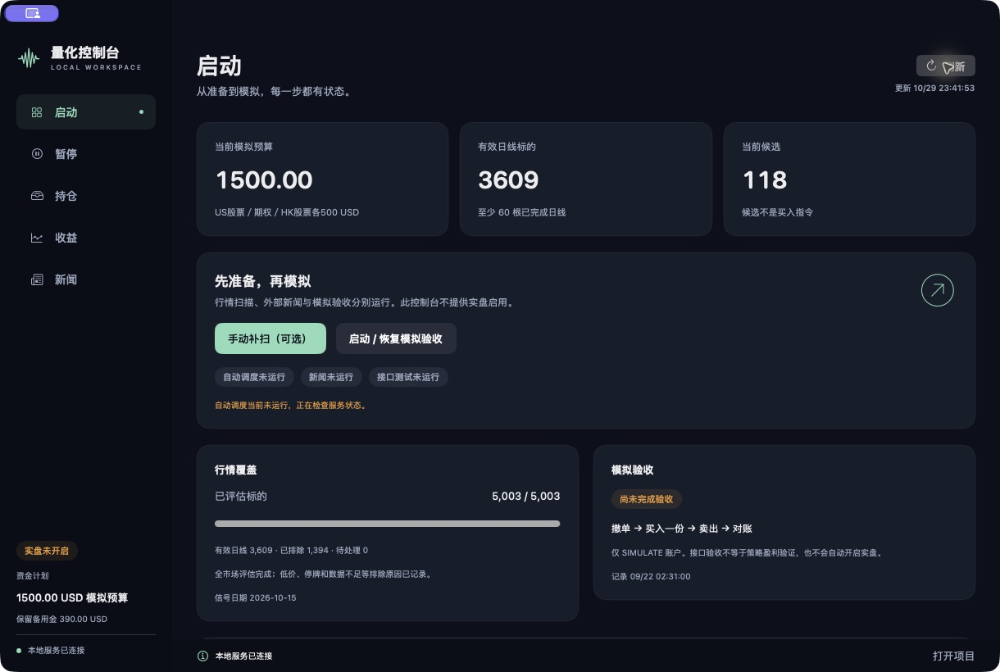

# moomoo 量化控制台（AegisQuant）

**简体中文** | [English](README.en.md)

基于 **moomoo / OpenD**，面向 **美股、港股、美国期权及期货研究** 的量化研究与模拟系统，串联行情、新闻、选股、风控、模拟订单执行和账户对账。

## 这是什么软件

这里主要展示原生 **moomoo 量化控制台**：`desktop/QuantDesktop.swift` 是中文 Mac 操作界面，`trading/` 是证券行情、新闻、模拟策略与对账代码。程序标识符保留 Python / Swift 的常用英文命名，界面和本页说明使用中文。

证券连接路径：**量化控制台 → 本机 Python 后台 → 官方 moomoo SDK → OpenD → moomoo 证券账户**。本软件不是 Binance 交易器；`binance_trader/` 为独立历史工具，不参与证券控制台的 API 配置。

## 市场覆盖与当前范围

| 市场 | 当前范围 |
| --- | --- |
| 美股股票 | 全市场筛选、做多波段模拟、风控与券商对账 |
| 港股股票 | 交易日历、整手及价位检查、模拟执行与对账 |
| 美国期权 | 合约研究及明确授权的 SIMULATE 订单传输验收 |
| 期货 | 仅有 FUTURE 记账分类预留和研究范围；无期货执行后台，也无已验证或已分配的执行资金通道 |

公开源码不代表已完成实盘准备、券商成交验收或盈利验证。`binance_trader/` 是仓库内另一个可选商品合约工具，其界面不能代表美港股证券控制台。

## 实际 moomoo 证券交易控制台



2026 年 10 月 29 日从本机现有 Mac 证券控制台直接截图，读取实际本地模拟账本和历史扫描记录。操作界面目前为中文。证券接入使用官方 moomoo Python SDK，通过本地 OpenD 通信（`trading/moomoo.py`），不是独立币安 API。

**截图状态：**本地状态服务以只读方式连接，OpenD 和交易工作进程均未运行。画面扫描信号日期为 2026 年 10 月 15 日；1,500 USD 为配置的模拟预算，不是真实账户权益。历史记录不代表当前券商在线、验收完成或盈利。本次截图未恢复策略、未提交订单。

## 基本运行逻辑

```text
行情 / 历史 K 线 / 新闻
          ↓
数据完整性、时效、品种与交易时段检查
          ↓
策略信号 + 新闻方向 / 风险过滤
          ↓
预算、仓位、亏损阈值与暂停状态检查
          ↓
模拟执行或已明确启用的交易通道
          ↓
查询订单 → 核验成交 → 更新持仓与账本
          ↓
止损 / 止盈 / 趋势反转 / 到期退出 → 对账
```

1. **启动与恢复**：读取本机配置和持久化账本，恢复已知订单及持仓。连接账户、保存设置或恢复凭据，不等于启动新开仓。
2. **收集与检查**：读取行情、已收盘 K 线和新闻；数据过期、扫描不完整、品种身份未核实或账户状态异常时，阻止新开仓。
3. **形成决策**：策略先产生候选方向，再检查新闻、资金、交易时段、仓位和亏损限制。信号成立仍可能因风控被拒绝。
4. **执行与核对**：记录下单意图和回包，查询真实订单状态，以核验结果更新账本。超时或结果未知时先查询、保留证据，避免盲目重发。
5. **持续管理**：后台管理已有仓位、保护单、撤单及对账。暂停新开仓不等于已经平仓；关闭网页也不等于后台已经停止。

各通道使用各自的配置、账户状态与执行保护。下述规则描述当前公开源码，实际参数以对应模块和本机配置为准。

## 交易逻辑

### 美股股票

- 采用做多的短期波段框架：基于已完成交易日的数据检查基础趋势、流动性及此前 5 个交易日高点突破。
- 可选高波动趋势筛选，结合 ATR 占比、趋势效率等指标排序；完整扫描和合格历史数据是准入前提。
- 仓位按可用预算、计划止损距离、手续费及滑点预留共同计算，不能仅按余额满仓买入。
- 波段模型的初始止损距离为 `1.5 × ATR14`，目标距离为 `3 × ATR14`；止损、止盈、趋势反转，或持有达到 5 个交易日且临近收盘时触发退出判断。
- 执行前再次核对新鲜双边报价、限价、市场日历、新闻和联合账户风险；先处理到期撤单及已有持仓退出，再考虑新开仓。

### 港股股票

- 使用核验后的香港交易日历及完整的上一交易日信号，检查做多信号、流动性和候选身份。
- 执行还需满足连续交易时段、整手股数、合法价位、费用、独立预算及账户对账要求。
- 已有持仓的退出管理独立于新的候选名单；缺少开仓条件时不会据此忽略持仓管理。

### 美国期权

- 当前独立期权流程主要用于 **SIMULATE 传输验收**，不是已验证盈利的期权策略。
- 按 `撤单测试 → 撤单确认 → 买入 → 买入确认 → 卖出 → 卖出确认 → 完整对账` 推进。
- 合约、报价、独立预算和持仓必须再次核验；未成交、回包不明或未知订单不能直接视为成功，也不能自动补发替代订单。

### 期货研究

期货目前仍处于研究及接入检查阶段。必须先核验合约资格、行情权限、乘数、最小价位、保证金、费用、交易日历、执行能力及独立预算。本仓库不宣称已经启用或验收美港市场的期货自动执行；独立币安工具的能力不能充当证券系统期货能力的证明。

## 配置自己的证券 API（moomoo / OpenD）

### 1. 安装 Python 依赖

```sh
python3 -m venv .venv
.venv/bin/python -m pip install -r requirements.txt
```

### 2. 安装并登录官方 OpenD

从 [moomoo 官方下载页](https://www.moomoo.com/download/OpenAPI) 安装 OpenD。在 **OpenD 自己的窗口**登录你的 moomoo 账户并完成验证。仅登录普通证券客户端不能代替 OpenD 登录。

本项目默认连接 `127.0.0.1:11111`，不要开放公网监听。这套连接使用 OpenD 的登录会话，不需要在本项目填写 Binance 式的 API Key / Secret，也不应把证券登录密码写进源码或提交到 GitHub。架构和权限以 [官方 API 文档](https://openapi.moomoo.com/moomoo-api-doc/en/intro/intro.html) 为准。

### 3. 只读检查连接和权限

在项目根目录执行：

```sh
.venv/bin/python connect.py --port 11111 --quotes --accounts
.venv/bin/python trade.py --port 11111 doctor
```

这些诊断不启动自动策略。先确认网关、行情登录、交易登录和模拟账户权限；客户端能看见的行情不一定有 API 权限，行情缺失不能当作已连接成功。

### 4. 使用你自己的模拟账户配置

`trading/config.example.json` 是配置示例，`live_stocks` 和 `live_options` 均保持 `false`。诊断可指定自己的配置：

```sh
cp trading/config.example.json data-local-config.json
.venv/bin/python trade.py --config data-local-config.json --port 11111 doctor
```

预算字段和风控上限需通过 `Config.validate()`，旧示例使用 NZD 口径，不等于截图所示已迁移的独立 USD 账本。公开仓库没有原运行账本，不会因填写配置自动获得截图中的部署状态。账户绑定必须使用你通过 OpenD 查询到的 **SIMULATE** 账户，US 与 HK 分别核验；示例 `000001` / `000002` 不能直接使用，也不要重置已有账本来绕过绑定检查。

当前证券适配器 `trading/moomoo.py` 的交易上下文使用 `SecurityFirm.FUTUAU` 并核对市场权限；其他地区/券商实体的账户不能假定直接兼容，需要先按官方文档核验并适配。官方 API 支持某类期货不代表本项目已经实现期货执行；本项目仍拒绝 FUTURE 新开仓。

## 配置自己的 AI 分析 API（可选、只读）

**证券控制台原有新闻功能是规则分析，不存在可以直接填写 AI Key 的 GUI 设置页。** 新增的 `trading/ai_analysis.py` 是独立命令行研究入口，不冒用币安工具的 AI 设置，也不会把回答接入买卖、仓位或风控控制。

你需要从所选模型提供商取得：

- 支持 Chat Completions 协议的 API 根地址，例如 `https://提供商域名/v1`；不要填写聊天网页地址。
- 该账户实际支持的模型名称。
- 该提供商的 API Key（与 moomoo 登录、证券权限完全不同）。

运行示例（将地址和模型名称替换为自己的）：

```sh
.venv/bin/python -m trading.ai_analysis \
  --base-url https://provider.example/v1 \
  --model your-model-name \
  --text '请分析我提供的公开公司公告，区分已知事实、推测、风险和失效条件。'
```

程序会隐藏输入地询问模型 Key，不保存密钥；也支持从 `AEGIS_AI_API_KEY` 环境变量读取。不要把 Key 写进命令参数、README 或 Git。公网接口必须 HTTPS，本机回环网关可用 HTTP；接口必须支持 `/chat/completions`，其他协议不能直接代入。

只有执行该命令时才发送 `--text` 明确提供的材料及研究提示词，不自动读取账户、持仓、账本或证券凭据。请只提供允许发给该服务商的公开内容。服务商可能收费；请求45秒超时，不自动重试。输出默认中文，仅供研究，**不会自动下单，不改变证券策略**。此模块通过隔离假服务测试，未使用真实模型 Key 进行付费联调；GUI 集成尚未实现。

## 目录与启动

| 路径 | 用途 |
| --- | --- |
| `trading/` | 美港股及期权行情、扫描、模拟执行、订单对账与风控 |
| `binance_trader/` | 币安后台、策略、新闻、AI 过滤及网页界面 |
| `desktop/` | 独立美港股 Mac 控制台（中文界面） |
| `binance_trader/desktop/` | 币安 Mac 启动器、钥匙串组件及构建脚本 |
| `tests/`、`binance_trader/tests/` | 回归测试 |
| `examples/` | 人工合成演示数据 |
| 根目录 Python 脚本 | 连接诊断、回测、验证与收益统计 |

### 从美港股工具开始

```sh
python3 -m venv .venv
.venv/bin/python -m pip install -r requirements.txt
.venv/bin/python trade.py doctor
```

需另外安装并登录官方 OpenD，具备相应行情和账户权限。先检查 `trading/config.example.json`，配置自己的本地模拟环境，再运行策略命令。`doctor` 进行诊断，不会启动自动策略。公开克隆不包含原账本、账户绑定及运行验收证据。

### Mac 证券控制台

操作控制台需要兼容的 Xcode/SwiftUI 工具链；当前本机 Command Line Tools 构建报告缺少 `SwiftUIMacros` 插件，不能声称操作控制台已重新构建成功。构建命令为：

```sh
zsh desktop/build.sh
```

生成 `量化控制台.app`，这是美港股证券控制台，目前界面仍为中文。此前新增的英文界面属于独立币安工具，不能表述为英文股票或期货控制台。本仓库不包含已构建的 App。

### 可选的独立币安工具

见 [币安工具说明](binance_trader/README.md)。它使用 `binance_trader/requirements.txt`、独立数据目录及单独执行权限，不是使用美港股研究与模拟工具的前提。

本仓库是脱敏源码快照：不包含运行数据库、余额、成交历史、凭据、本机报告、依赖目录及已构建 App。部署代码和对应测试中的模拟账户编号已替换为示例 `000001`（US）和 `000002`（HK），部署前需配置并验证自己的账户绑定。

## 版权、商业使用与来源标注 / Copyright, commercial use, and attribution

### English

**Copyright © 2026 Ffffsss123. All rights reserved except as expressly granted by the repository [LICENSE](LICENSE).** This notice covers original material the author has the right to license. Third-party components remain subject to their own licenses.

Personal use, study, modification, derivative development, commercial use, and profit-generating use are permitted only with clear attribution to the original author and this repository. Paid products, services, trading for profit, personal rewrites, republication, copying, and redistribution must retain the source and must not present the author's work as wholly independent original work.

Retain this notice and an accessible original repository link:

> Based on or uses AegisQuant by Ffffsss123.
>
> Original source: https://github.com/Ffffsss123/AegisQuant
>
> Copyright © 2026 Ffffsss123. Subject to the original repository LICENSE.

When providing software or services to others, include attribution in the README / documentation and a user-accessible About, Copyright, or Credits page. Source distributions must also retain the copyright and LICENSE. Private use or trading solely for your own profit requires retaining the notice in the used copy's README or equivalent project documentation, without publishing trading records.

Identify modified versions as modified and do not imply the author's endorsement. **Use that fails to satisfy attribution or other license conditions is outside the permission granted; the author reserves the right to seek cessation, pursue liability, and bring legal proceedings under applicable law.** See [LICENSE](LICENSE) for the complete terms.

### 简体中文

**Copyright © 2026 Ffffsss123。保留所有权利；使用许可仅按本仓库 [LICENSE](LICENSE) 授予。** 本声明适用于作者有权授权的原创部分，第三方组件仍遵循各自许可。

允许个人使用、学习、修改、二次开发、商业使用及盈利，但上述使用均必须明确注明原作者和本仓库来源。商业产品、收费服务、量化交易盈利使用、个人改写、转载、复制或分发均不得删除或隐瞒来源，也不得把原作者的作品冒充为完全独立原创。

请保留以下声明及可访问的原仓库链接：

> 本项目基于 Ffffsss123 的 AegisQuant 项目开发或使用。
>
> 原始仓库：https://github.com/Ffffsss123/AegisQuant
>
> Copyright © 2026 Ffffsss123。使用须遵守原仓库 LICENSE。

对外提供软件或服务时，请在 README / 使用文档及用户可查看的“关于 / 版权 / 致谢”页面保留该声明；分发源码时，还须保留版权和 LICENSE。个人自用或仅用于自身交易盈利且不对外分发时，应在所使用副本的 README 或等效项目说明中保留声明，不要求公开交易记录。

修改版本须注明已经修改，不得暗示原作者为其背书。**不履行来源标注或其他许可条件的行为不在本许可授权范围内；作者保留依法要求停止使用、追究责任及提起诉讼的权利。** 完整条款以 [LICENSE](LICENSE) 为准。
