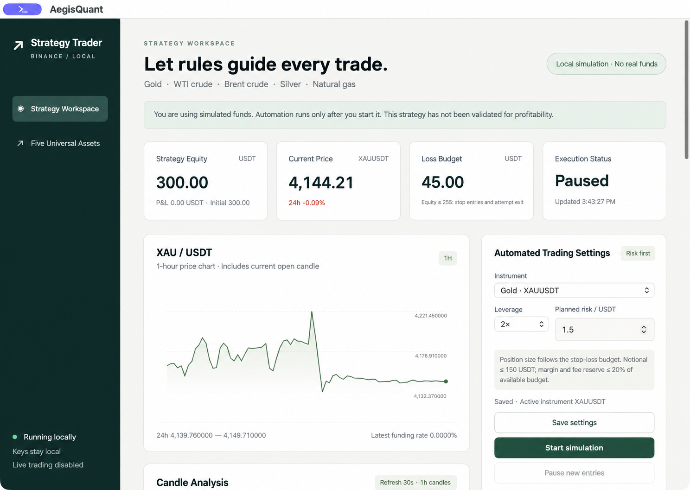

# AegisQuant

**English** | [简体中文](README.zh-CN.md)

Quantitative research, simulation, and macOS desktop tools for US stocks, Hong Kong stocks, US options, and Binance commodity contracts. The system connects market data, news, strategy signals, position sizing, order execution, and ledger reconciliation. This public source snapshot does not establish live-trading readiness or successful broker execution acceptance, and does not promise returns.

## Application preview



English-language UI preview translated from a local simulation screenshot captured on October 4, 2026. It illustrates the price chart, risk controls, and strategy settings; the English labels are a presentation translation. The displayed 300 USDT is a simulated starting balance, not a live account or current execution status.

## Runtime workflow

```text
Market data / historical candles / news
                  ↓
Validate completeness, freshness, instruments, and trading sessions
                  ↓
Strategy signals + news direction / risk filters
                  ↓
Check budgets, positions, loss limits, and pause controls
                  ↓
Simulation or an explicitly enabled execution channel
                  ↓
Query orders → verify fills → update positions and ledgers
                  ↓
Stop loss / take profit / trend reversal / time exit → reconcile
```

1. **Start and recover:** load local configuration and persistent ledgers, then recover known orders and positions. Connecting an account, saving settings, or restoring credentials does not start new entries.
2. **Collect and validate:** read quotes, closed candles, and news. Stale data, incomplete scans, unverified instruments, or abnormal account states block new entries.
3. **Evaluate:** generate candidate signals, then check news, capital, market sessions, position limits, and loss controls. A valid signal can still be rejected by risk checks.
4. **Execute and reconcile:** persist order intent and responses, query order status, and update the ledger from verified results. A timeout or unknown result requires investigation before any retry.
5. **Manage positions:** continue position protection, cancellation, and reconciliation. Pausing new entries does not mean positions are closed; closing a browser page does not stop the backend.

Each channel has its own configuration, account state, and execution safeguards. The rules below describe the published source; the corresponding modules and local configuration determine actual parameters.

## Trading logic

### US stocks

- A long-only short-term swing framework checks the underlying trend, liquidity, and a breakout above the previous five sessions' highs using completed daily data.
- An optional volatile-trend filter ranks candidates using ATR percentage and trend efficiency. Complete scans and qualified historical data are required for entry.
- Position size accounts for available capital, planned stop distance, fees, and slippage reserves.
- The swing model uses an initial stop distance of `1.5 × ATR14` and a target distance of `3 × ATR14`. Exit checks cover stops, targets, trend reversal, and a maximum five-session holding period near the close.
- Execution rechecks fresh two-sided quotes, limit prices, market calendars, news, and joint-account risk. Expired-order cancellation and existing-position exits take priority over new entries.

### Hong Kong stocks

- Entry checks use a verified Hong Kong trading calendar and a complete previous-session scan, including long signals, liquidity, and candidate identity.
- Execution also requires a continuous trading session, valid board lots and price ticks, fee reserves, an independent budget, and account reconciliation.
- Existing-position exits are managed independently of the current entry candidate list.

### US options

- The independent options flow primarily performs **SIMULATE transport acceptance**, rather than representing a validated profitable options strategy.
- Its sequence is `cancellation test → cancellation confirmation → buy → buy confirmation → sell → sell confirmation → full reconciliation`.
- Contracts, quotes, independent budgets, and positions are revalidated. Unfilled or unknown orders do not count as success and must not trigger blind replacement orders.

### Binance commodity contracts

- The source allows gold, silver, WTI crude, Brent crude, and natural gas contracts, with one enabled instrument and one position at a time. Unsupported exchange products are rejected.
- Signals use closed candles, `EMA20 / EMA60` trend checks, and breakouts of the previous 20 candles' highs or lows. New entries are evaluated only within the configured post-close window.
- When verified news provides a direction, the breakout must agree. A candle-only fallback requires healthy news collection and explicit fallback permission; missing news or a blocking risk does not grant that permission.
- An enabled AI direction is an additional filter. Healthy news, risk checks, and a matching closed-candle breakout remain required; model prose cannot place an order by itself.
- Initial stop distance is the greater of `2 × ATR14` and `1%` of price. Trades with a stop distance above `8%` are skipped; the target distance is twice the stop distance. The strategy does not average down to replace a stop.
- Sizing incorporates planned loss, fees, slippage, funding, margin, leverage, and exchange quantity increments. Daily or cumulative loss limits lock new entries.
- The same candle cannot repeatedly open positions. Unknown orders create a persistent lock. Demo and live fills, protective orders, exits, and remote positions require verification; local simulation cannot reproduce a complete order book or real liquidation paths.

## Layout and setup

| Path | Purpose |
| --- | --- |
| `trading/` | US/HK equities and options data, scanning, simulation, reconciliation, and risk controls |
| `binance_trader/` | Binance backend, strategy, news, AI filters, and browser interface |
| `desktop/` | macOS console source and build scripts |
| `tests/`, `binance_trader/tests/` | Regression tests |
| `examples/` | Synthetic demonstration data |
| Top-level Python scripts | Connection diagnostics, backtests, validation, and return reports |

```sh
python3 -m venv .venv
.venv/bin/python -m pip install -r requirements.txt

# Check local simulation mode and configuration before starting.
.venv/bin/python -m binance_trader
```

The Binance interface defaults to `http://127.0.0.1:8766`; see the [Binance tool guide (Chinese)](binance_trader/README.md). US/HK broker integration requires official OpenD software and appropriate account/data permissions. See `trading/config.example.json`. Begin with simulation and read-only diagnostics; live execution requires separate explicit configuration and actions.

This is a sanitized source snapshot. Runtime databases, balances, trade history, credentials, local reports, dependencies, and built application bundles are excluded. Simulated account bindings in deployment code and its tests use example IDs `000001` (US) and `000002` (HK). Configure and validate your own bindings before deployment.

## Copyright, commercial use, and attribution / 版权、商业使用与来源标注

### English

**Copyright © 2026 Ffffsss123. All rights reserved except as expressly granted by the repository [LICENSE](LICENSE).** This notice covers original material the author has the right to license. Third-party components remain subject to their own licenses.

Personal use, study, modification, derivative development, commercial use, and profit-generating use are permitted only with clear attribution to the original author and this repository. Paid products, services, trading for profit, personal rewrites, republication, copying, and redistribution must retain the source and must not present the author's work as wholly independent original work.

Retain this notice and an accessible original repository link:

> Based on or uses AegisQuant by Ffffsss123.
>
> Original source: https://github.com/Ffffsss123/AegisQuant
>
> Copyright © 2026 Ffffsss123. Subject to the original repository LICENSE.

When providing software or services to others, include attribution in the README / documentation and a user-accessible About, Copyright, or Credits page. Source distributions must also retain the copyright and LICENSE. Private use or trading solely for your own profit requires retaining the notice in the used copy's README or equivalent project documentation, without publishing trading records.

Identify modified versions as modified and do not imply the author's endorsement. **Use that fails to satisfy attribution or other license conditions is outside the permission granted; the author reserves the right to seek cessation, pursue liability, and bring legal proceedings under applicable law.** See [LICENSE](LICENSE) for the complete terms.

### 简体中文


**Copyright © 2026 Ffffsss123。保留所有权利；使用许可仅按本仓库 [LICENSE](LICENSE) 授予。** 本声明适用于作者有权授权的原创部分，第三方组件仍遵循各自许可。

允许个人使用、学习、修改、二次开发、商业使用及盈利，但上述使用均必须明确注明原作者和本仓库来源。商业产品、收费服务、量化交易盈利使用、个人改写、转载、复制或分发均不得删除或隐瞒来源，也不得把原作者的作品冒充为完全独立原创。

请保留以下声明及可访问的原仓库链接：

> 本项目基于 Ffffsss123 的 AegisQuant 项目开发或使用。
> 原始仓库：https://github.com/Ffffsss123/AegisQuant
> Copyright © 2026 Ffffsss123。使用须遵守原仓库 LICENSE。

对外提供软件或服务时，请在 README / 使用文档及用户可查看的“关于 / 版权 / 致谢”页面保留该声明；分发源码时，还须保留版权和 LICENSE。个人自用或仅用于自身交易盈利且不对外分发时，应在所使用副本的 README 或等效项目说明中保留声明，不要求公开交易记录。

修改版本须注明已经修改，不得暗示原作者为其背书。**不履行来源标注或其他许可条件的行为不在本许可授权范围内；作者保留依法要求停止使用、追究责任及提起诉讼的权利。** 完整条款以 [LICENSE](LICENSE) 为准。
