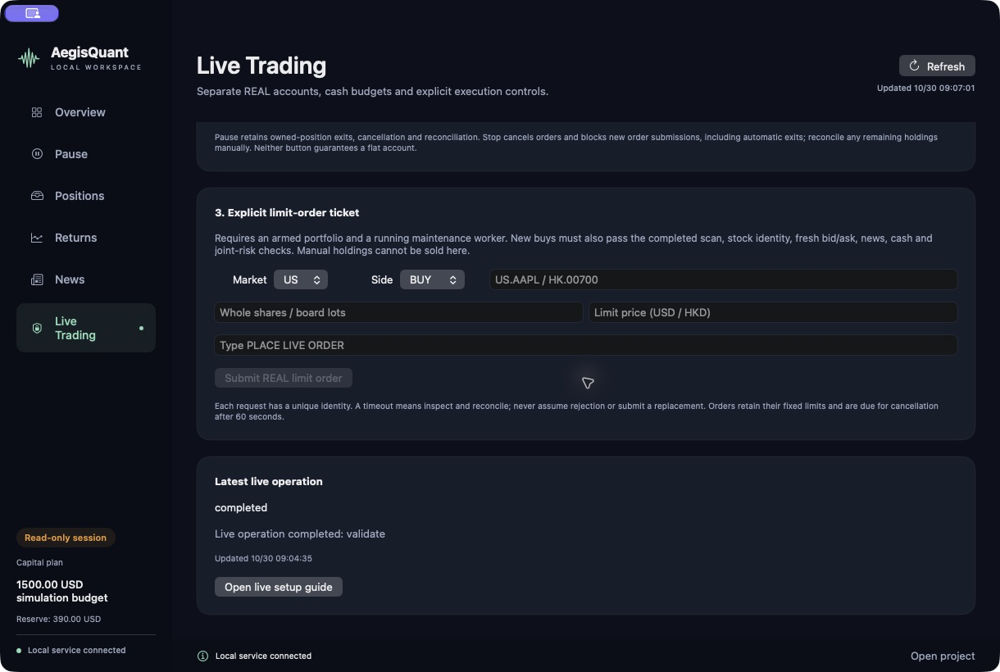

# 实盘股票启用与执行

[English](live-trading.md) · [中文 README](../README.zh-CN.md)

英文控制台新增 **Live Trading**，范围是美股、港股普通股票的现金实盘。当前仅完成隔离假券商测试，没有用真实资金成交验收；本次开发没有绑定真实账户、启用实盘或下单。期权、期货保持关闭。

## 运行范围

- 实盘单独保存于 `data/trading/live/`，不切换、重置或复用模拟账本和模拟资金。
- 美股用 USD、港股用 HKD 记账；只使用已持有的可用现金，不融资、不入金、不真实换汇。已配置实盘预算合计最多 890 USD 等值，US 买入还须保留现有现金中的 390 USD 备用金。
- US/HK 策略合计最多持有 2 只股票，待成交和未知开仓单占槽。已有人工持仓只作基线，不归入策略，也不能在此卖出。
- 只发普通限价单，按官方日历在连续交易时段执行，检查整股、港股整手和合法价位。实盘报价必须为 30 秒内双边报价，价差不超过 0.2%。不放宽实盘退出价差。
- 可选自动买入接的是原始日线趋势执行引擎，检查前一交易日完整信号和新闻。**这不是模拟环境的 1–5 日 ATR 波段引擎；不提供交易所托管止损，也未接通 ATR 实盘止损。** 日线引擎管理趋势反转退出，真实执行仍受报价和限价成交约束。
- `automatic_entries` 默认 `false`：可在启动维护后台后逐笔确认限价单，后台仍管理策略持仓和趋势退出。原始日线引擎每市场每交易日决策一次，美股自动决策沿用纽约时间 09:35–09:40 窗口，不是持续盘中择时策略。设为 `true` 并启用、启动后台后，日线策略可以自动创建符合条件的真实订单。

截图来自实际英文软件的只读本机状态服务。画面中的 DISABLED 和 WORKER OFFLINE 是截图时的关闭状态，不代表实盘验收通过；侧栏 1,500 USD 属于模拟预算，不是实盘获配资金。

## 1. 创建配置

先按 [证券适配器说明](broker-adapters.md) 安装和登录匹配的本地网关，核验证券实体、API 权限、行情权限及 REAL 账户。其他证券平台仍需实现并验证适配器，不能随便填一个 API Key 就使用。

```sh
.venv/bin/python -m trading.live_trading template
```

也可在 **Live Trading → Create config draft** 创建本机配置。打开 `data/trading/live/config.json`，填入自己的 REAL 账户编号、原币现金预算 `budget_native`、原币亏损上限 `loss_native`、每单费用预留 `fee_reserve_native`、联合美元亏损上限 `joint_loss_limit_usd` 和证券实体 `firm`。

US 金额为 USD，HK 金额为 HKD。联合亏损上限必须为正数且不超过 100 USD。费用预留最少 USD 3 / HKD 20；港股还要覆盖按股数计算的保守成交取整费用上界，预留不足会拒单。模板中账户为空、金额为 `null`，不能直接启用。

准备完成后账户和预算不可直接修改；不要删除账本绕过限制。配置文件、真实账本和原始回包不可上传 GitHub。

## 2. 先完成验收与核验

每个已配置市场都需要自己的自然模拟买卖闭环、策略持仓归零、无未决订单和健康对账。US 接口测试、reset 卖出和人工退出不算自然证据；HK 检查提交与结算日志、自然策略退出事件及新鲜的空仓风险快照。空账本、截图和部署完成都不能替代验收。

```sh
.venv/bin/python -m trading.live_trading validate
.venv/bin/python -m trading.live_trading refresh-fx
.venv/bin/python -m trading.live_trading prepare
.venv/bin/python -m trading.live_trading status
```

`validate` 运行保护回归并记录当前代码指纹；新实盘委托还会核验当前指纹与后台加载的实现。代码更新后应先暂停买入，检查并对账未决订单，再验证新代码并安全重启维护后台，不能重置账本。`refresh-fx` 仅获取 ECB 公开参考用于联合记账，不进行换汇。港股目录、类别核验、整手价位和日历资料也必须保持有效。

`prepare` 只查询自己明确选择的 REAL 账户、核验现金和现有订单，建立**暂停且未启用**的实盘账本，不下单、不启动实盘后台。已有手工持仓保留为外部基线。

## 3. 明确启用，再单独启动

在交易平台的官方本机网关内手动解锁交易；本软件不收集交易密码。附带 SDK 的要求见 [官方限价下单接口](https://openapi.moomoo.com/moomoo-api-doc/en/trade/place-order.html)。

在 **Live Trading** 输入 `ENABLE LIVE STOCKS`，点击 **Enable live stocks**；再单独点击 **Start live execution worker**。命令行等效操作为：

```sh
.venv/bin/python -m trading.live_trading enable --confirmation 'ENABLE LIVE STOCKS'
.venv/bin/python -m trading.live_trading run
```

启用必须通过当前保护指纹、对应市场模拟闭环和最新真实账户对账/估值；启用本身不启动后台。首笔真实提交还须等待后续当地交易日及正常交易时段。重新打开软件不自动启动实盘后台，重复后台会被进程锁拒绝。

如果只想逐笔批准买入，保持 `automatic_entries=false`。设为 `true` 后，已启用并启动的后台可按日线策略创建真实订单。

## 4. 限价单与状态核对



已启用且后台运行时，在 **Explicit limit-order ticket** 填市场、股票代码、方向、整股/整手数量及原币限价，输入 `PLACE LIVE ORDER` 后提交。买入仍需通过完整前一交易日扫描、合格做多信号、品种、报价、新闻、现金、持仓和联合亏损检查。卖出只能处置本实盘账本拥有的持仓。

每笔请求保留唯一编号，每笔订单先持久化意图再发给券商。超时或回包不明记录 UNKNOWN，只能先查询恢复，不能假设失败并重发。界面提示“操作已排队”不代表券商接单或成交。订单不会追价，手续费未核实会阻断后续提交。非执行时段允许使用最近已完成交易日的已核验最新成交价估值；这不放宽任何真实下单报价条件。

## 5. 暂停、停止与故障处理

```sh
.venv/bin/python -m trading.live_trading pause
.venv/bin/python -m trading.live_trading stop
.venv/bin/python -m trading.live_trading status
```

- **Pause live buys** 立即保存本机暂停锁存，不等待网关；运行中的后台继续尝试已有策略持仓退出、撤单和对账。状态健康的普通手动暂停可以再次明确启用恢复；未知订单、未解决告警、亏损或停止锁存不会被自动清除。
- **Latch live stop** 阻止全部新订单，包括自动退出单；后台继续撤单与对账。剩余持仓需要人工关注，不等于已平仓。
- 未成交策略订单在 60 秒后到期撤单，后台每 5 秒巡检，先处理对账/撤单，再处理依赖报价的交易决策。网络、限流或网关故障可能延迟回包；发起撤单不代表撤单成功。
- **Reconcile once（单次对账）**，或 `.venv/bin/python -m trading.live_trading maintain`，只做查询、对账及到期撤单，不运行策略决策，也不创建买卖订单。
- 单个市场对账或估值失败会阻断新买入，但健康市场仍可处理自己的到期撤单和已核验策略持仓退出；故障市场不能绕过自身账户、报价、费用和持仓检查。
- 后台存活心跳与慢速 SDK 查询分开运行；心跳正常不等于数据合格，新鲜估值、报价和账户核验仍分别检查。
- 汇率过期阻止新买入，但不应阻止原币撤单和维护。未知订单、异常持仓、亏损锁存、配置变化和不健康对账都必须调查，没有通用“清空错误继续交易”按钮。
- 本机退出管理依赖电脑、网络、网关和后台持续运行；关窗口不停止后台，电脑离线则无法继续管理，需直接检查券商账户。

本机诊断位置：`data/trading/live/us.sqlite`、`hk.sqlite`、`report.json` 和 `data/desktop/live_*.log`。原始回包和状态变化留存本机；GUI 状态不返回账号或原始回包。完整实现及边界见 [英文说明](live-trading.md)。
